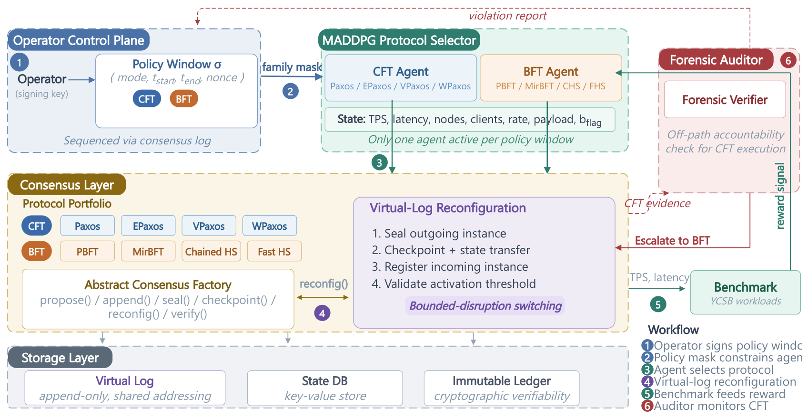

# Altun

## Architecture

<p align="center">
  
</p>

## Repository Structure

| Directory | Contents |
|---|---|
| `Altun-core/` | Consensus protocol implementations, the forensic auditor, the virtual-log reconfiguration plane, and the deployment scripts (Go) |
| `Altun-core/bft/` | BFT engines: HotStuff fork (Chained HotStuff, Fast HotStuff) and MirBFT (PBFT, MirBFT) |
| `Altun-core/proxy/`, `Altun-core/altunsm/` | Online switching proxy with checkpoint certification over a replicated key-value state machine |
| `Altun-RL/` | RL-based protocol selector (Python) |
| `formal/` | TLA+ models of the policy-window boundary and of checkpoint certification |

# Altun-core and Altun-RL
### Altun-core (Go)

Consensus protocol implementations behind a uniform gRPC `ConsensusInstance` API (propose, seal, checkpoint, restore). Currently integrates eight protocols spanning CFT and BFT families:

| Protocol | Family | Key Property |
|---|---|---|
| Paxos | CFT | Single-leader, two-phase |
| EPaxos | CFT | Leaderless, parallel commits |
| VPaxos | CFT | Dynamic leader reconfiguration |
| WPaxos | CFT | Geo-distributed, locality-aware quorums |
| PBFT | BFT | Classic three-phase, single leader |
| MirBFT | BFT | Parallel leaders, pipelined |
| Chained HotStuff | BFT | Pipelined views, linear communication |
| Fast HotStuff | BFT | Fast-path optimization, reduced RTT |


### Altun-RL (Python)

MADDPG-based online learning framework for protocol selection.

| File | Description |
|---|---|
| `online_maddpg.py` | Training / inference entry point |
| `inference_maddpg.py` | Inference from a saved checkpoint |
| `maddpg_env.py` | PettingZoo-compatible environment; hysteresis gate; switch logging |
| `reward.py` | Reward functions (`best_and_pre` is the default) |
| `altun_env_mutation.py` | Workload mutation strategies (block schedules, drift benchmarks) |
| `baseline_selectors.py` | Thompson Sampling, UCB1, Greedy, BestFixed selectors |
| `run_selector_comparison.py` | Selector strategy comparison driver |
| `utils.py` | Config management, benchmark bridge, controller API client |
| `systems/config_default.json` | Observation and action space definition |

---

### MADDPG Agent Design

Two cooperative agents:

- **CFT agent** — selects among: Paxos, EPaxos, VPaxos, WPaxos
- **BFT agent** — selects among: PBFT, MirBFT, Chained HotStuff, Fast HotStuff


## Quick Start

### Prerequisites

```bash
# Python (Altun-RL)
conda create -n rl python=3.12
conda activate rl
pip install -r Altun-RL/requirements.txt

# Go (Altun-core), Go 1.23+ (the module toolchain is fetched automatically)
cd Altun-core
make                 # core binaries and proxy tools into bin/, BFT engines into bin/ and mir/bin/
```

### Start the Altun stack

```bash
# 1: Configure the cluster variables in Altun-core/bin/env.sh, then start the stack
cd Altun-core/bin
bash start_altun.sh
# Protocol switching through the altun-controller
```

### Run RL agent

```bash
# 2: Training
python Altun-RL/online_maddpg.py \
    --config_file systems/config_default.json \
    --project_dir <path-to-Altun-core>/bin \
    --batch_size 8 \
    --max_steps 1500 \
    --record_file <saved_folder>/log.csv \
    --saved_folder <saved_folder> \
    --reward_fn altun_reward \
    --reward_top_num <top_k> \
    --reward_discount <discount> \
    --mutate_env_fn <mutation_fn> \
    --saved_steps 20 \
    --reward TPS
```

```bash
# 2: Inference
python Altun-RL/inference_maddpg.py \
    --config_file systems/config_default.json \
    --project_dir <path-to-Altun-core>/bin \
    --checkpoint <path-to-saved-model>
```

---

## Key Configuration

- `Altun-RL/systems/config_default.json` — observation space, action space (protocol pools), benchmark parameters
- `Altun-core/bin/env.sh` — cluster variables (SSH user, host naming, remote directory, WAN emulation)
- `Altun-core/bin/config_RL.json` — protocol and workload parameters of the current step, written by the selector

## Third-Party Code

`Altun-core/consensus/cft` derives from [Paxi](https://github.com/ailidani/paxi) (MIT). `Altun-core/bft/hotstuff` is a fork of [relab/hotstuff](https://github.com/relab/hotstuff) (MIT). `Altun-core/bft/mirbft` is the [MirBFT](https://github.com/hyperledger-labs/mirbft) research prototype (Apache-2.0). The license files are kept in those directories.
